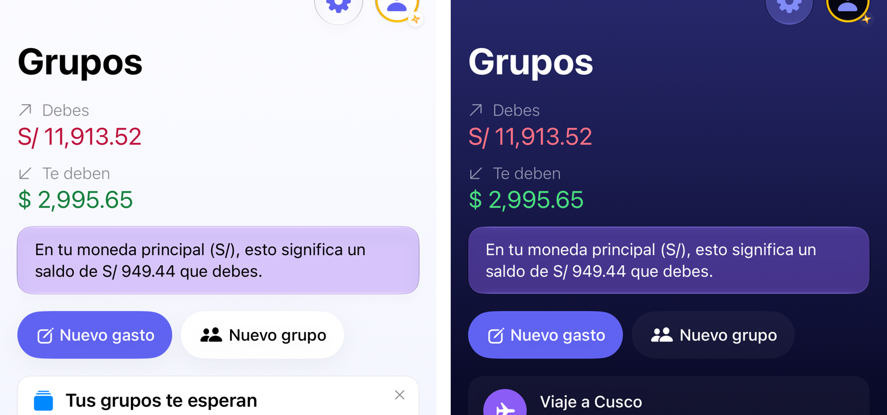
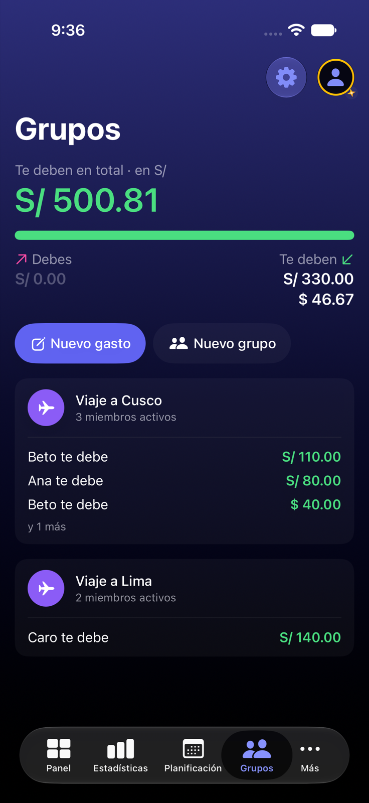
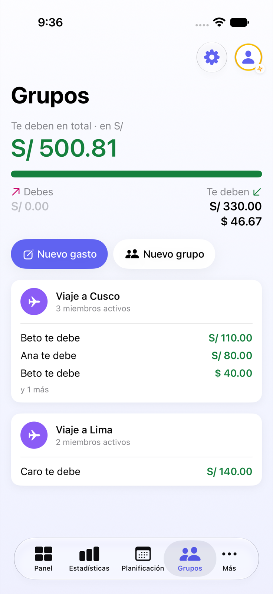

# Grupos 2.2: la parte de arriba de la lista

Jürgen eligió la **propuesta 2** el 2026-11-03, con la **paleta B** y un **tope de tres líneas por lado**.

| Antes | Después (oscuro) | Después (claro) |
|---|---|---|
|  |  |  |

Vídeo del después: [despues.mp4](despues.mp4).

## Lo que se decidió

- **Cifra grande:** el neto de todo Yala en tu moneda principal. Va en rosa si debes, en verde si te deben y sin color si
  estás a mano. Solo sale en Yala completo, porque en Yala gratis no hay moneda principal.
- **Barra:** reparte lo que debes (rosa, a la izquierda) y lo que te deben (verde). Las dos partes se pasan a la moneda
  principal. Lleva rellenos sólidos, sin degradados ni brillos.
- **Los dos lados:** «Debes» a la izquierda y «Te deben» a la derecha, con una línea por moneda. Caben como mucho tres
  líneas: con cuatro monedas o más salen las dos mayores y «y N más». Si un lado está vacío, dice 0.00 en gris.
- **Colores (paleta B):** «Debes» va en el rosa de marca y «Te deben» en verde. Cambian también las tarjetas de grupo y el
  widget.

## Lo que se miró para decidir

- Cuatro propuestas: `propuesta-1-anillo.png`, `propuesta-2-barra.png`, `propuesta-3-chips.png` y
  `propuesta-4-tarjetas.png`.
- La 2 y la 3 en siete escenarios: debes más, te deben más, varias monedas, solo te deben, solo debes, a mano y Yala
  gratis (`propuesta-*-escenarios-*.png`).
- Cuatro paletas sobre la 2 ya construida: `paleta-*.png`.
