# Grupos 2.2: tres propuestas para el resumen y las filas

Jürgen elige una. La implementa otra sesión.

Las capturas salen del simulador (iPhone 17 Pro, iOS 27.0), con la app de verdad alrededor: barra, pestañas, buscador y fondo
del tema. El resumen y las filas son maquetas con datos fijos, parecidos a los tuyos:

- **Jurpi ❤️** (2 personas): debes S/ 2,774.14 a Pía R. y Pía R. te debe $ 1,110.76.
- **Matri** (2 personas): debes S/ 8,314.38 a Maria P. y Maria P. te debe $ 1,884.89.
- **Viaje a Cusco** (6 personas): debes S/ 30.00 a Diego M.; Ana L., Beto R., Carla S. y Eva P. te deben.
- **Neto en tu moneda principal:** S/ 566.81 que debes. Sale de convertir a soles lo que te deben en dólares con
  1 USD = 3.40 PEN. En la app real usará los tipos de cambio de Yala.

Las tres cumplen los cinco acuerdos del 30-oct:

1. «Te deben» va en verde y «debes» en rojo anaranjado, con el mismo peso visual.
2. Cada grupo nombra a las personas: «Debes a Maria P. S/ 8,314.38» y «Maria P. te debe $ 1,884.89». Salen como mucho tres;
   el resto se resume en «y N más».
3. Con Yala completo, un aviso de cristal a lo ancho dice el neto en tu moneda principal. En Yala gratis no aparece.
4. Primero lo que debes y después lo que te deben, en el resumen y en cada grupo.
5. El parpadeo al entrar está arreglado (abajo).

Cada propuesta tiene capturas en los temas Claro, Oscuro, Liquid Glass (el tuyo) y Rosa (degradado).

## Propuesta 1 · «Dos líneas iguales»

| Oscuro | Claro | Liquid Glass | Rosa |
|---|---|---|---|
| 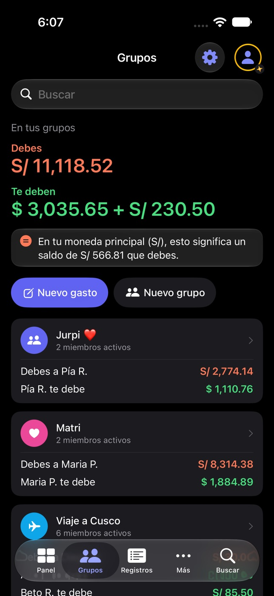 | 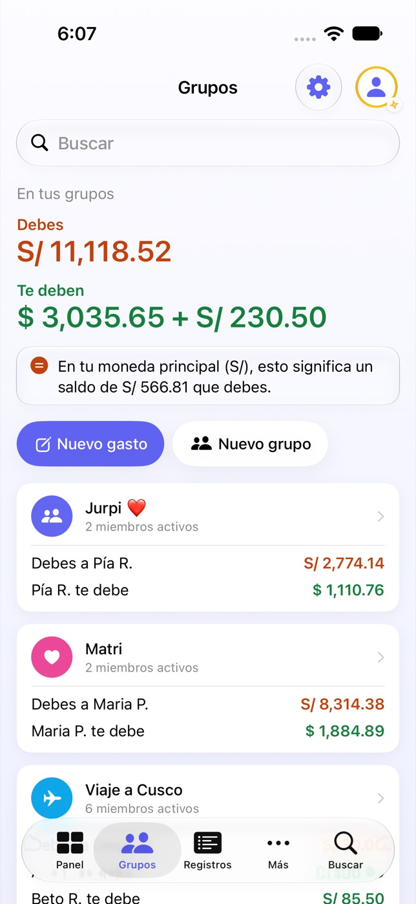 | 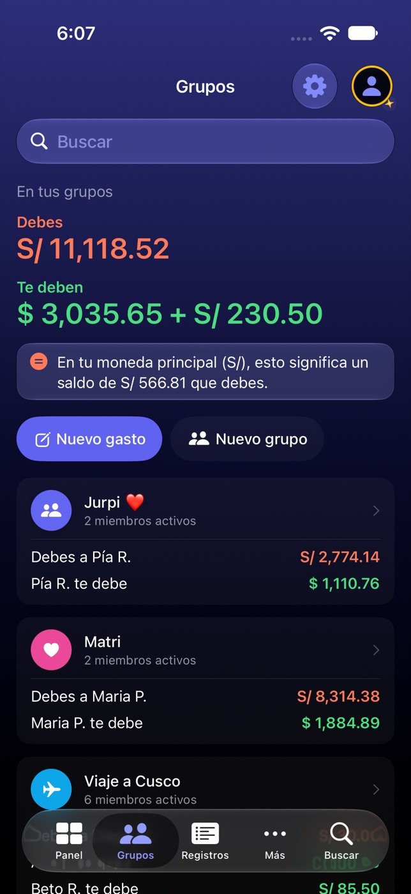 | 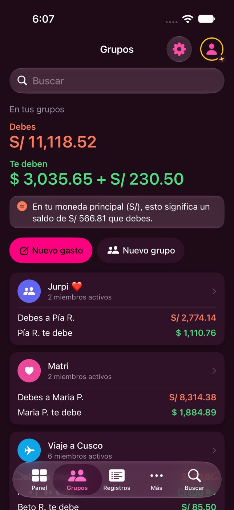 |

El resumen pone «Debes» y «Te deben» uno debajo del otro, con cifras del mismo tamaño. Debajo va el aviso del neto. Cada
grupo es una tarjeta con su cabecera y una fila por persona: el texto a la izquierda y el monto en color a la derecha.

- **A favor:** es la que mejor se lee de un vistazo. Las dos cifras pesan igual y cada persona tiene su fila.
- **En contra:** es la más alta. Con tres grupos el tercero ya queda bajo la barra de pestañas, y a tamaño de texto grande
  cabrán menos grupos por pantalla.

## Propuesta 2 · «Dos tarjetas lado a lado»

| Oscuro | Claro | Liquid Glass | Rosa |
|---|---|---|---|
| 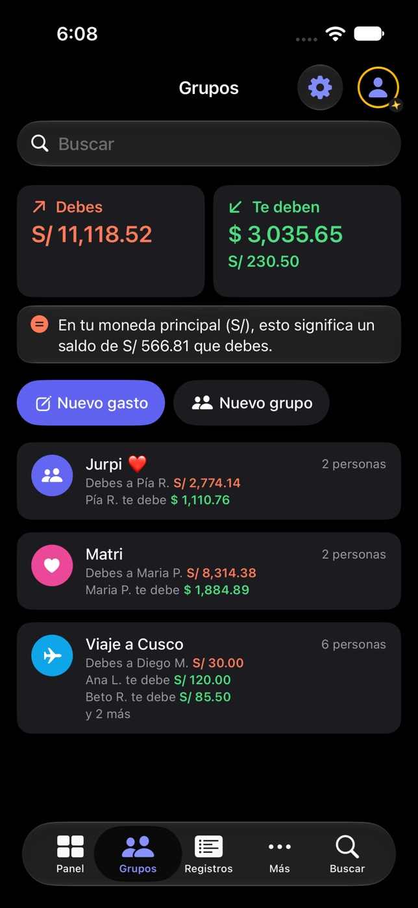 | 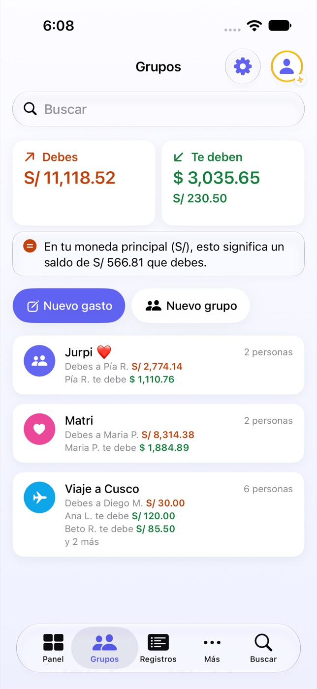 | 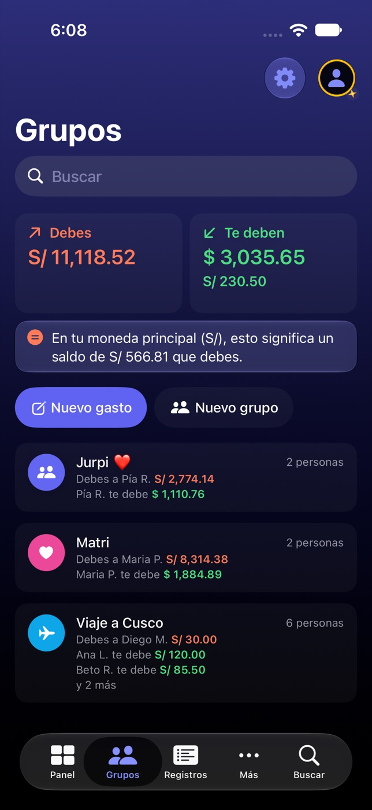 | 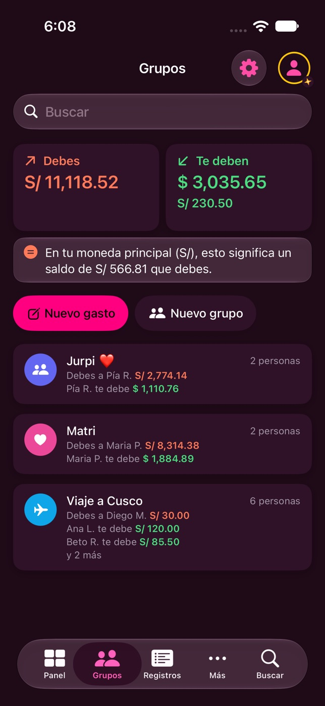 |

El resumen son dos tarjetas: «Debes» a la izquierda y «Te deben» a la derecha. Cada moneda va en su línea dentro de la
tarjeta. El aviso del neto va debajo, a lo ancho. Cada grupo es una fila compacta, y debajo del nombre van las personas en
letra pequeña, con el monto en color.

- **A favor:** es la más compacta. Caben los tres grupos enteros y las dos cifras quedan a la misma altura.
- **En contra:** las filas de personas van en letra pequeña. Las tarjetas son estrechas, así que con montos de siete cifras
  la letra encogerá.

## Propuesta 3 · «El neto como titular»

| Oscuro | Claro | Liquid Glass | Rosa |
|---|---|---|---|
| 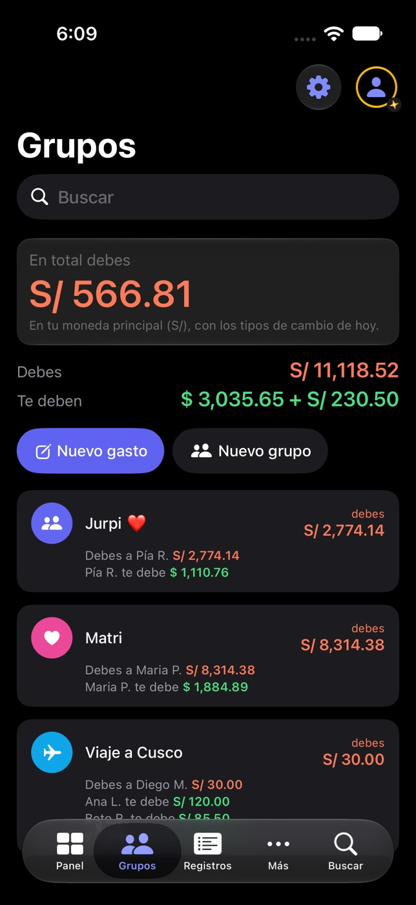 | 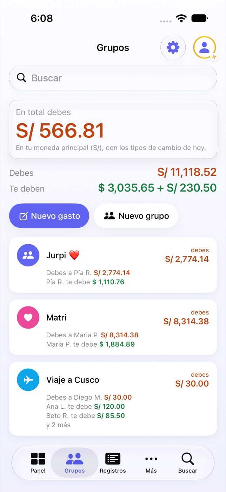 | 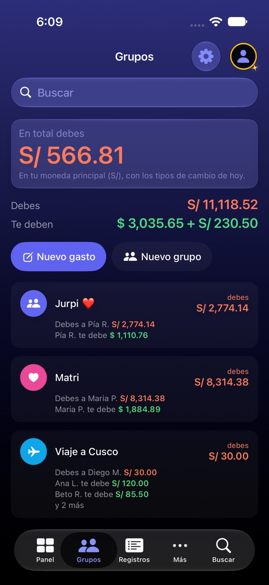 | 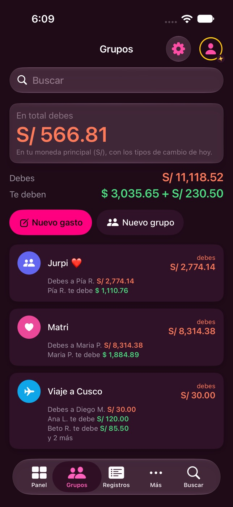 |

La cifra grande es el neto en tu moneda principal: «En total debes S/ 566.81», en una tarjeta de cristal. Debajo van
«Debes» y «Te deben» en dos líneas. Cada grupo enseña a la derecha su monto principal, como Splitwise, y debajo a las
personas.

- **A favor:** contesta primero a la pregunta de si vas a favor o en contra. Es lo más parecido a Splitwise.
- **En contra:** la cifra grande depende del tipo de cambio, así que se mueve aunque nadie añada nada. Además, el monto de
  la derecha de cada grupo solo enseña una moneda. Matri dice «debes S/ 8,314.38» aunque Maria P. te deba $ 1,884.89.

## En Yala gratis

| Propuesta 1 | Propuesta 3 |
|---|---|
| 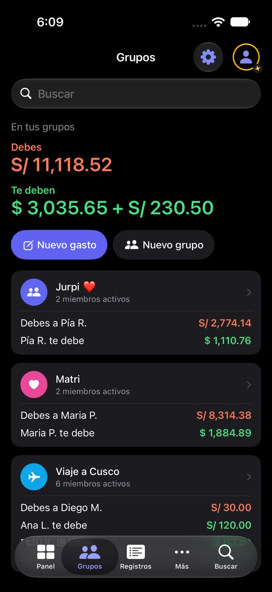 | 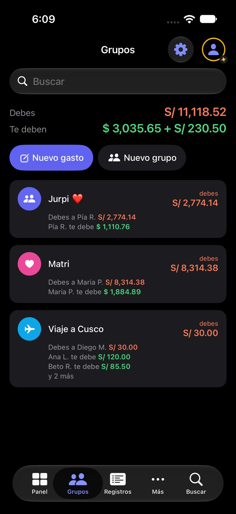 |

Sin moneda principal no hay neto. La propuesta 1 y la 2 solo pierden el aviso. La 3 pierde su titular y queda con las dos
líneas.

## Mi recomendación: la propuesta 1

Cumple los cinco acuerdos sin trucos. Las dos cifras pesan igual, cada persona tiene su fila legible y el neto acompaña
como aviso, sin ocupar el sitio de lo que de verdad se debe. La 3 es tentadora, pero su cifra grande cambia con el tipo de
cambio, y en una pantalla de deudas eso confunde. Si la 1 te parece demasiado alta, la 2 es la alternativa: mismo
contenido, más apretado.

## Qué haría falta al implementarla

- Dos colores nuevos en el diseño del tema, uno para «te deben» y otro para «debes», con su test de contraste en los diez
  temas (como `ThemeTokenContrastTests`). En las maquetas: verde #15803D en claro y #4ADE80 en oscuro; rojo anaranjado
  #C2410C en claro y #FF7A59 en oscuro.
- El cálculo del neto aislado y con tests: signo, cero, una moneda y varias.
- El texto del aviso en los 7 idiomas.
- Revisar la regla «En Grupos los montos no llevan color» de `.claude/rules/swiftui-ds.md`, que este rediseño sustituye.

## El parpadeo al entrar (arreglado en este PR)

| Antes: al volver a Grupos | Después |
|---|---|
| 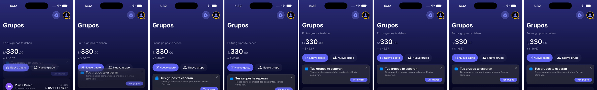 | 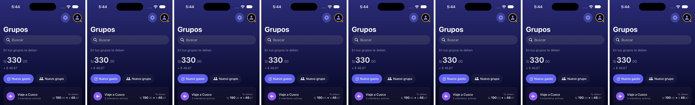 |

Son fotogramas cada 0,1 s desde el toque en la pestaña. Antes, la barra reservaba el sitio del buscador vacío durante unos
0,4 s y luego lo plegaba de golpe. Ahora el buscador se queda siempre visible bajo el título y el resumen no se mueve.

Queda un deslizamiento suave de unos 0,3 s la primera vez que entras a Grupos tras abrir la app. Es otra causa y tiene su
propia card.

En las capturas, el título sale a veces grande y a veces pequeño. Depende de cómo aterrizó la prueba, no de la propuesta.
