# Registro unificado 2.2: tres propuestas

Jürgen elige una. La implementa otra sesión. Si no elige, se implementa la A.

El objetivo es que registrar se vea casi igual en tres pantallas:

- **Nuevo registro** (el «+»), que es la referencia.
- **Aprobación**: tocar un borrador en la Bandeja («Editar borrador»).
- **Nuevo gasto de Grupos**: la moneda sigue en el signo del monto, porque ahí cabe cualquier moneda.

Cada imagen pone las tres pantallas lado a lado. Hay versión en Oscuro, Claro y Liquid Glass (tu tema). Las capturas
salen del simulador (iPhone 17 Pro, iOS 27.0) con la app de verdad. Es maqueta la zona de los selectores y, en Grupos,
también la cabecera, la línea de debajo de los selectores y, en la C, la fila del reparto. La maqueta fue temporal y no
está en el repo.

Datos de ejemplo, iguales en todas: la tarjeta **BCP Visa** en soles con su línea en dólares, la subcategoría
**Restaurantes** (de Alimentación) y la etiqueta **Trabajo**. En Grupos, «Cena en Cusco», S/ 240 entre tres en «Viaje a
Cusco».

## Hoy

| Oscuro | Claro | Liquid Glass |
|---|---|---|
| 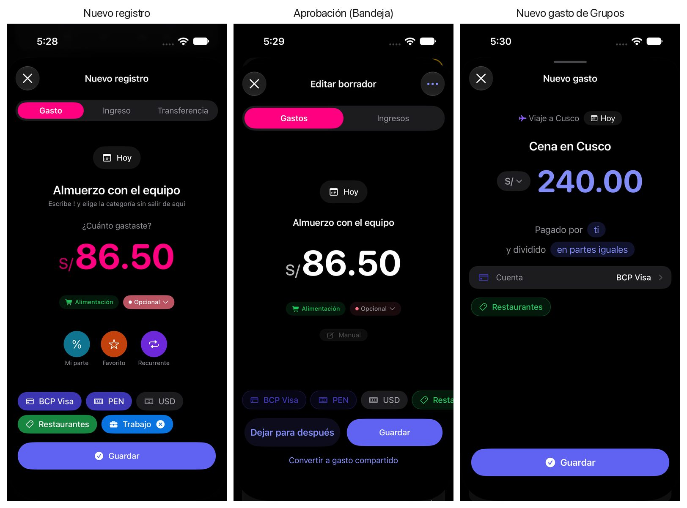 | 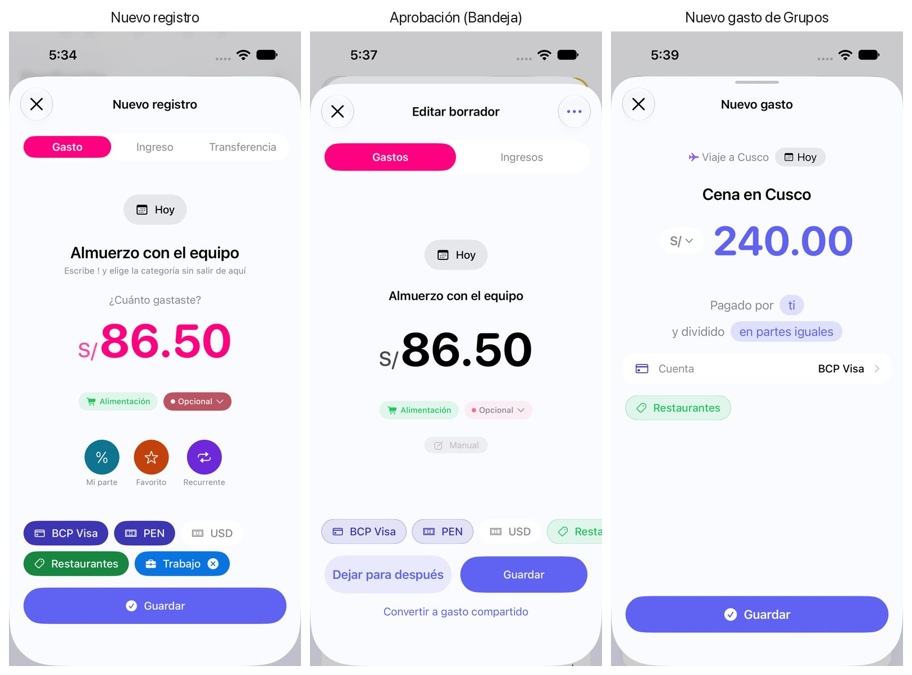 | 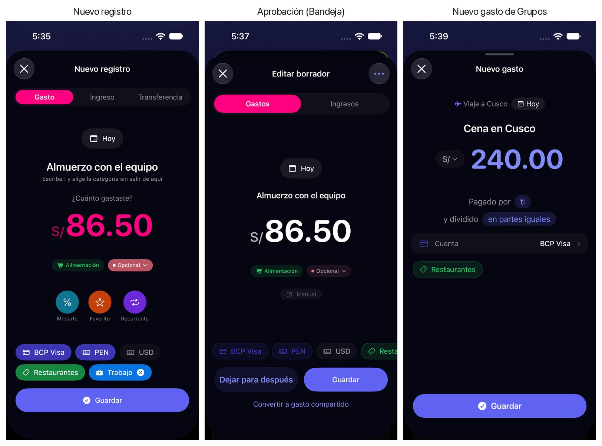 |

- **Nuevo registro** reparte los selectores en filas que bajan cuando no caben. Con la tarjeta quedan dos: la tarjeta y
  sus dos líneas arriba, la categoría y la etiqueta abajo. Lo elegido va relleno de color.
- **La aprobación** los pone todos en una sola fila que se desplaza de lado. Las líneas quedan sueltas entre la tarjeta y
  la categoría, y la etiqueta se sale por la derecha. Además, lo elegido solo va teñido, no relleno: «PEN» elegido y
  «USD» sin elegir se distinguen menos que en Nuevo registro. Por eso «USD» parece un campo por rellenar.
- **Grupos** usa otra forma para cada cosa: la cuenta es una fila ancha dentro de la tarjeta de «Pagado por» y la
  subcategoría es una pastilla suelta. Grupo y fecha van en letra pequeña, y abajo queda mucho hueco.

## Propuesta A · «La aprobación copia a Nuevo registro»

| Oscuro | Claro | Liquid Glass |
|---|---|---|
| 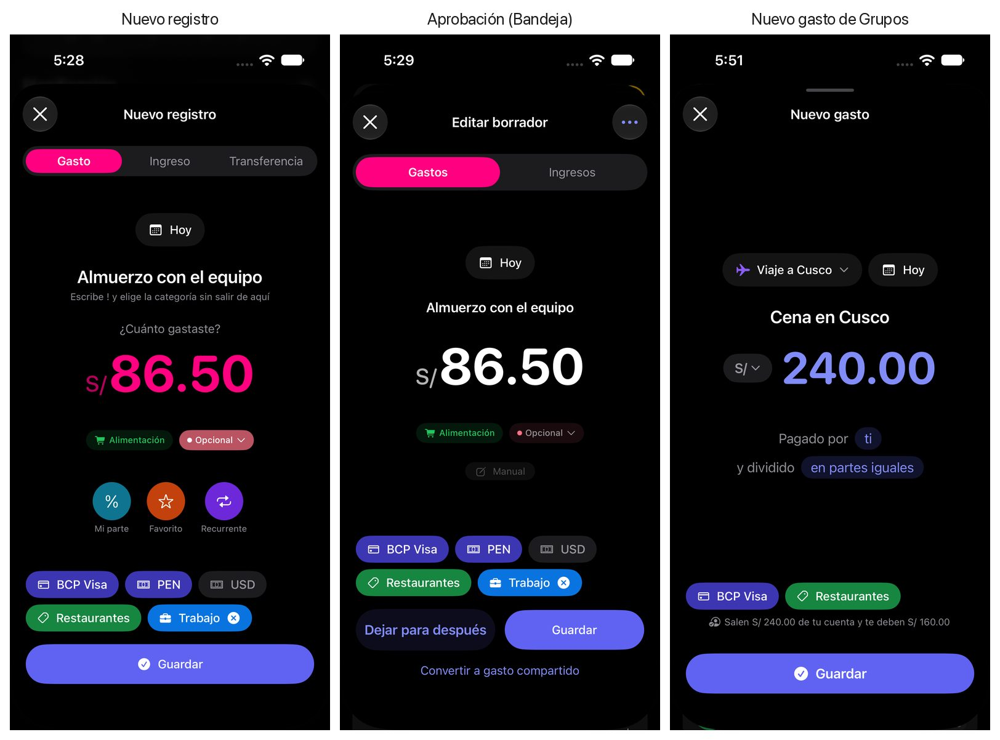 | 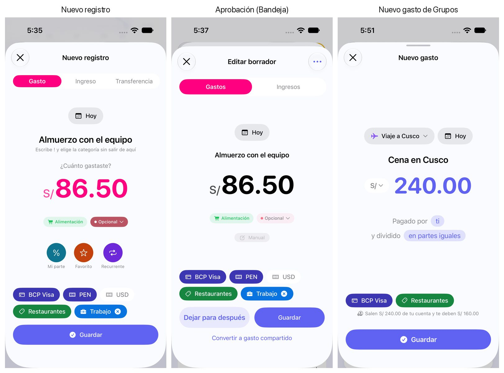 | 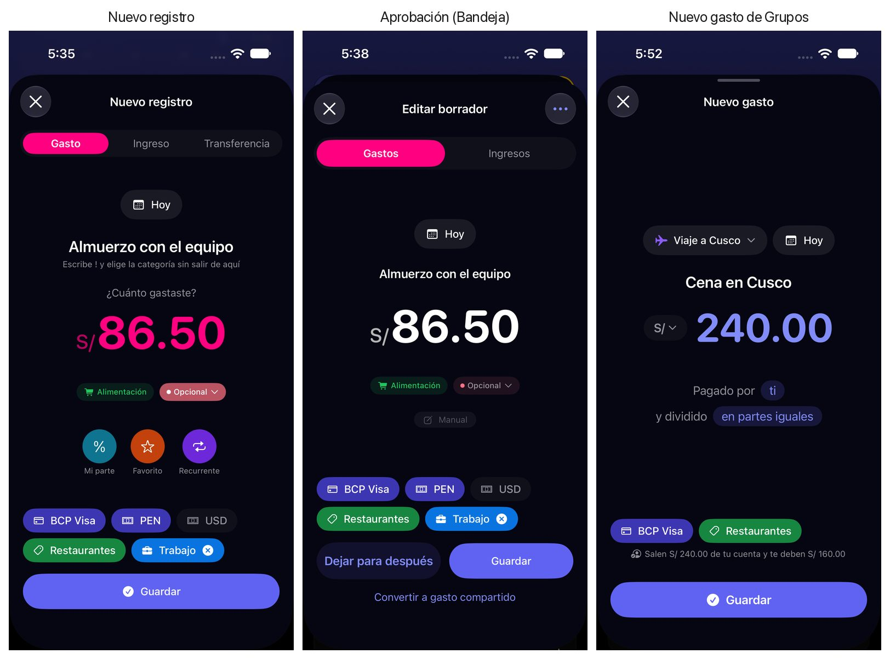 |

- **Nuevo registro** no cambia.
- **La aprobación** pasa a las mismas dos filas y a las mismas pastillas rellenas. La línea elegida se ve rellena y la
  otra se lee como alternativa, junto a su tarjeta.
- **Grupos** usa las mismas pastillas: cuenta y subcategoría, juntas, justo encima de «Guardar», como en las otras dos.
  Grupo y fecha pasan a pastillas grandes, como la fecha de Nuevo registro. El contenido se reparte a lo alto en vez de
  dejar el hueco abajo. Debajo de los selectores va una línea útil: «Salen S/ 240.00 de tu cuenta y te deben S/ 160.00».
  Es lo que de verdad pasa en tus registros cuando pagas tú.

**A favor:** es el cambio más pequeño y conserva Nuevo registro, que ya te gusta. Las tres pantallas usan la misma pieza.

**En contra:** con las pastillas no se ve qué es cada cosa sin leer el icono. La línea sin elegir sigue siendo una pastilla
gris, como en Nuevo registro: se entiende por estar al lado de la tarjeta, no por un rótulo.

## Propuesta B · «Filas con nombre»

| Oscuro | Claro | Liquid Glass |
|---|---|---|
| 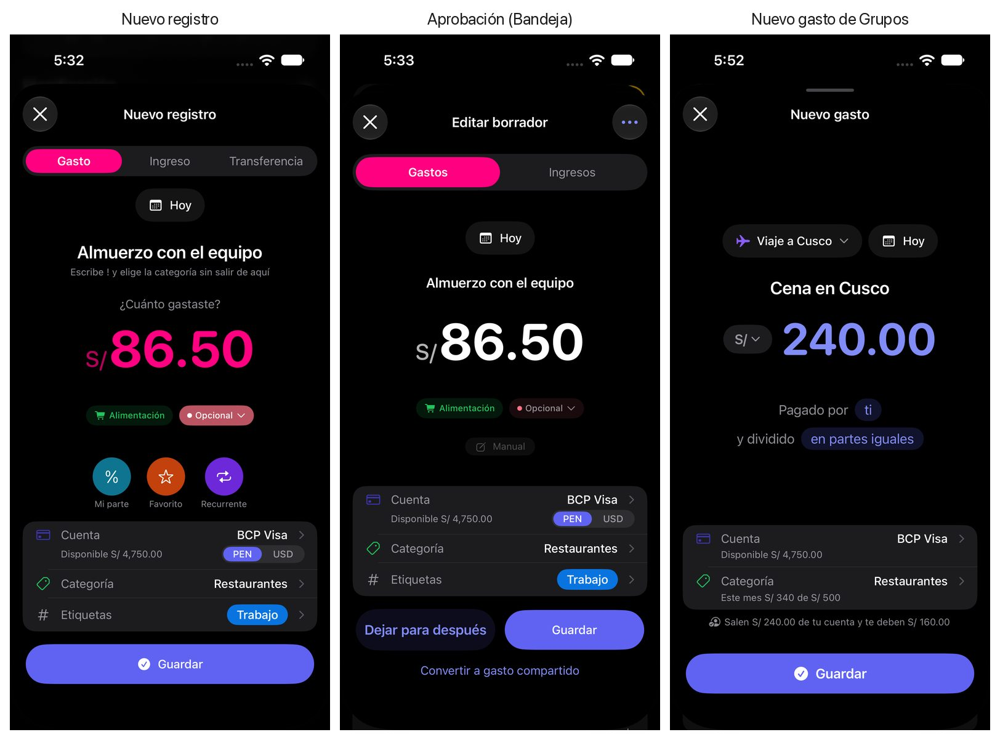 | 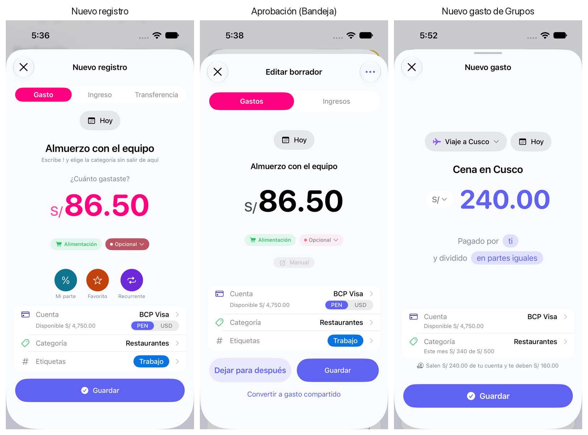 | 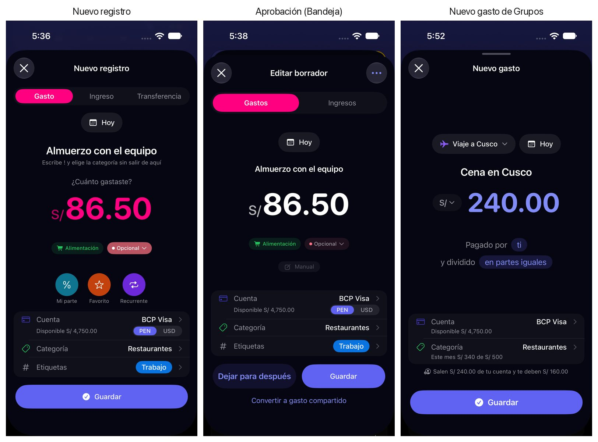 |

Un diseño nuevo, común a las tres. Los selectores van en una tarjeta con una fila por cosa: **Cuenta**, **Categoría** y
**Etiquetas**, cada una con su nombre a la izquierda y lo elegido a la derecha.

- Las líneas de moneda van dentro de la fila de Cuenta, como un interruptor «PEN | USD». Una de las dos siempre está
  encendida, así que la otra no puede parecer un campo vacío.
- Bajo la cuenta va su disponible. En Grupos, bajo la categoría va lo gastado este mes.
- **Grupos** usa la misma tarjeta, sin etiquetas (el formulario de grupo no tiene) y sin interruptor de moneda.

**A favor:** es la más clara. Cada cosa tiene su nombre y la línea de moneda es inequívoca. Se parece a la fila de cuenta
que Grupos ya tiene y a «Detalles» de un borrador de Yala IA, que ya usa filas con nombre.

**En contra:** es la más alta. En Nuevo registro la tarjeta llega justo hasta «Guardar» en un iPhone 17 Pro y empuja
hacia arriba el monto. En un iPhone pequeño habrá que desplazar. Cambia Nuevo registro, que hoy está bien.

## Propuesta C · «Dos casillas con dato»

| Oscuro | Claro | Liquid Glass |
|---|---|---|
| 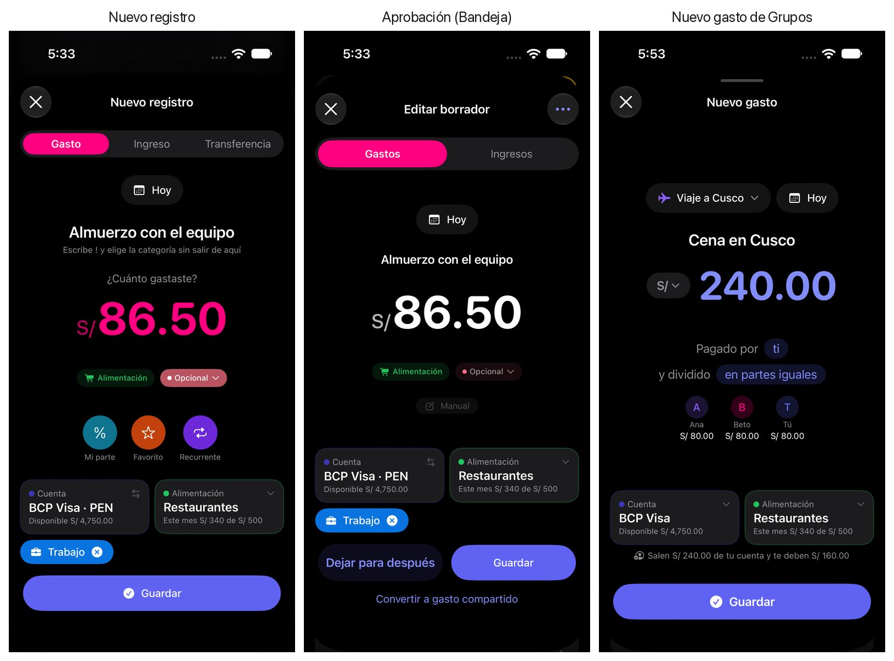 | 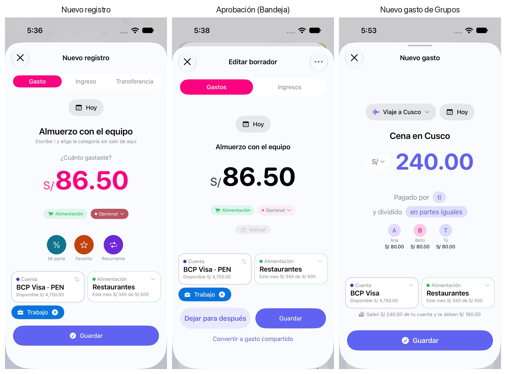 | 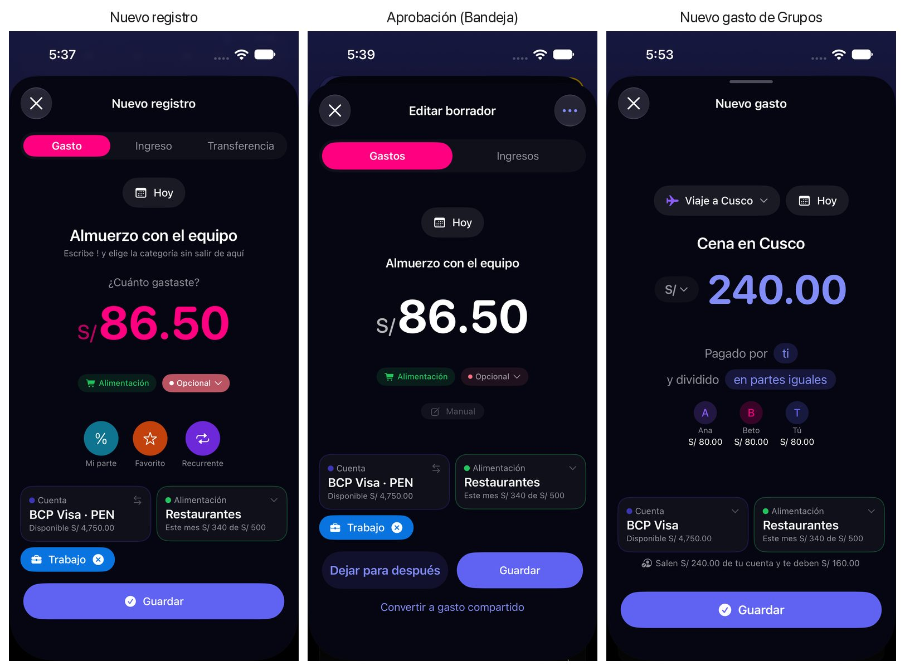 |

Cuenta y categoría van en dos casillas iguales, lado a lado. Cada casilla tiene un rótulo arriba, lo elegido en grande y un
dato útil debajo. Las etiquetas van en pastillas debajo.

- La línea va dentro del nombre: «BCP Visa · PEN», con un icono de cambiar. La línea que no se usa no se pinta.
- La casilla de categoría lleva su categoría padre como rótulo y lo gastado este mes.
- **Grupos** añade, bajo «Pagado por», lo que le toca a cada persona («Ana S/ 80.00 · Beto S/ 80.00 · Tú S/ 80.00»).

**A favor:** es la que más aprovecha el espacio, con información útil en las tres pantallas. Cuenta y categoría pesan lo
mismo y se ven a la vez.

**En contra:** cambiar de línea pasa a ser un gesto escondido. Hoy son dos pastillas a la vista. Con nombres de cuenta
largos, la casilla encoge la letra. Y es la que más trabajo pide: el dato de cada casilla hay que calcularlo.

## Mi recomendación: la A, y opcionalmente el reparto de la C en Grupos

Resuelve lo que pediste con lo que ya funciona. La confusión de la aprobación venía de la fila única y del relleno
flojo, no de las pastillas en sí. Copiando Nuevo registro, las tres pantallas hablan igual y Nuevo registro no se toca.

Grupos gana con A lo que pedías: grupo y fecha grandes, el mismo selector para cuenta y subcategoría, y una línea útil
debajo, que dice cuánto sale de tu cuenta y cuánto te deben. Si quieres más información útil ahí, la fila «cuánto le toca a cada uno» de la C encaja en Grupos sin cambiar
nada de las otras dos.

La B es la más clara, pero gasta el alto que Nuevo registro necesita. La C es la más rica, pero esconde el cambio de
línea.

## Qué haría falta al implementar

**Con la A:**

- Aprobación: la fila con desplazamiento pasa a dos filas. Todas sus pastillas pasan a ir como en Nuevo registro: la
  tarjeta, sus líneas y la subcategoría, rellenas; las etiquetas, con su propio color; y la marca de lo que falta.
  Hoy solo van teñidas y no marcan nada.
- Grupos: la fila de cuenta sale de la tarjeta de «Pagado por» y pasa a pastilla. La marca de «falta la cuenta» va con
  ella, y hoy es distinta de la de las pastillas: hay que elegir una. Dos ficheros de XCUITest usan el identificador de
  esa fila, y la pastilla lo conserva. Grupo y fecha pasan a pastillas grandes, y el reparto a lo alto usa el mismo
  molde que Nuevo registro.
- La línea de debajo solo sale cuando pagas tú, que es cuando se pide la cuenta. Va en los 16 idiomas de la app.
- Fuera de las tres pantallas hay dos sitios con los mismos selectores: el editor de favoritos (la misma fila con
  desplazamiento que la aprobación) y las hojas de la Bandeja que completan un borrador de grupo (pastillas teñidas, en
  una fila fija). Con la A quedarían distintas. Conviene decidir si entran.

**Con la B o la C, además:**

- «Disponible» no existe para una tarjeta: Yala no guarda su límite de crédito, y su saldo es lo que debes. En una
  tarjeta, la casilla diría «Saldo» o «Usado este mes». En una cuenta de débito, el saldo sí sale del cálculo que ya
  existe.
- Lo gastado en la categoría este mes ya se calcula (presupuestos y estadísticas). Lo nuevo es traerlo al formulario.
  «S/ 340 de S/ 500» solo tiene sentido con presupuesto; sin él, quedaría «Este mes S/ 340».

Las cifras de «Disponible» y «Este mes» de las maquetas son fijas, de ejemplo.
